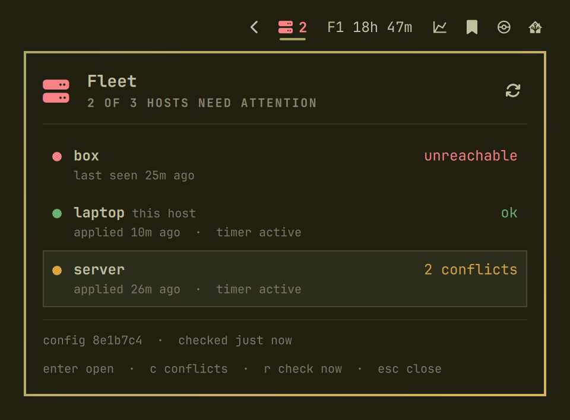

<p align="center">
  <picture>
    <source media="(prefers-color-scheme: dark)" srcset="assets/logo-dark.svg">
    
  </picture>
</p>

<p align="center">
  <a href="https://github.com/RolfKoenders/fleet/actions/workflows/ci.yml"></a>
  <a href="https://github.com/RolfKoenders/fleet/releases"></a>
</p>

# fleet

Fleet keeps the setup of your coding agents the same on every machine. You keep instructions, skills, MCP servers, settings and encrypted secrets in one private git repo, called your config, and fleet makes each machine match it.

If a machine holds something different, fleet stops and reports a conflict instead of overwriting it.

## Getting started

Install fleet and create your config:

```sh
curl -fsSL https://raw.githubusercontent.com/RolfKoenders/fleet/main/install.sh | sh
fleet new ~/fleet-config
```

The new repo is a commented example with placeholder skills and MCP servers. Ask your agent to run `fleet agent` and follow the onboarding recipe, or edit `hosts/` and `catalog/` yourself. `fleet init` fails until the placeholders are gone.

Publish it as a private repo:

```sh
cd ~/fleet-config
git add -A && git commit -m "Start my fleet config"
gh repo create fleet-config --private --source . --remote origin --push
```

Set up this machine, using its name from `hosts/`. Init prints an age key once, so save it in your password manager:

```sh
cd ~/fleet-config
fleet init laptop
```

Then add your other machines from this one:

```sh
fleet init server
```

## Working with fleet

Change the config, check the result, and publish it:

```sh
fleet diff
fleet push -m "Add a skill"
```

`fleet push` applies the change on every machine with an `ssh:` line in its host file. Every machine also pulls and applies by itself every 30 minutes. On a terminal it shows each host's progress live and leaves a summary; piped, it prints one timestamped line per host start and result.

| Command | What it does |
|---|---|
| `fleet status` | Report this machine; `--all` asks every machine over ssh; `--conflicts` lists this machine's conflicts in full, reading only |
| `fleet bridge [--view <screen>] [--host <name>]` | The full-screen view of every host (needs a terminal), optionally opened on a screen and a host; pushes and doctor only on your confirmation. See [the bridge](docs/bridge.md) |
| `fleet doctor` | Start this machine's MCP servers, check each answers and measure how large its tools are (saved as the doctor result); `--all` asks every machine over ssh. Runs commands with real credentials and may download packages, so it runs only when you ask |
| `fleet context` | Show how much each agent on this machine loads before the first prompt (instructions, skill descriptions, MCP tool definitions) as coloured bars and an estimate in tokens, with the largest items; `--all` asks every machine over ssh and draws all the bars on one scale, so you can see which machine carries the most. MCP sizes come from the last `fleet doctor`; reads only, starts no server |
| `fleet diff` | Show what an apply would change |
| `fleet apply` | Make this machine match its config |
| `fleet push` | Publish the config and apply it; `--host <name>` applies only on that host |
| `fleet adopt` | Take ownership of an MCP server or skill that already matches |
| `fleet secrets` | Edit, set or rekey encrypted secrets |
| `fleet skills update` | Move pinned skill sources to their latest commit; `--review` shows what changed first and asks per source |
| `fleet update` | Move the pinned tool version to the newest release (or the latest commit of a branch, see `track` in `fleet.yaml`) and print what changed |
| `fleet demo` | Try the bridge on made-up hosts in a throwaway sandbox; `--shell` gives a shell instead |
| `fleet agent` | Print what an agent needs to know, including task recipes |

Add `--json` to any command for output a script can read.

### Reading a skill update before it moves

A skill is instructions your agents follow, so a third-party update changes what they do. `fleet skills update --review [<source>]` reads each pinned source that would move, without moving anything, and reports the commits between the pins, each skill you use that changed with its diff size (other changed skills are only counted), and what to look at:

```
acme-skills  c19e2a1 → 7d04f6b, 14 commits, 6 of your 38 skills changed (3 others)

  ~ grilling                 +12 −3
  ! diagnose  scripts/trace.sh   new script; new URL https://…
  ! tdd       SKILL.md           allowed-tools: + Bash(curl:*)
  i triage    SKILL.md           description changed
```

Warnings (`!`) are a file with the exec bit, a new script, a new URL, a new `bash` or `sh` code block in `SKILL.md`, a change to `allowed-tools`, and a new hooks or settings file. A changed `description` is info (`i`), because it changes when the skill triggers. The flags are a reading aid, not a verdict.

On a terminal it then asks for each source: `d` shows the full diff of the skills you use, `y` moves the pin, `n` keeps it. Without a terminal, or with `--json`, it only reports, and a pin moves only with `--yes`. Followed sources are never reviewed.

To review a source every time without typing `--review`, put `review: true` on it in `catalog/skills.yaml`. Switch it on for skills other people write and leave it off for your own: a plain `fleet skills update` then reviews the first and moves the second as before. Only a pinned source can have it.

## In the Omarchy menu bar

On [Omarchy](https://omarchy.org/), a bar widget shows the health of every host as one icon, so you notice a conflict or an unreachable machine without opening a terminal. Its panel has a row for each host, naming its first conflict, and opens the bridge on the one you pick. It only runs `fleet status --all --json`, which reads. The screenshot shows made-up hosts.

<p align="center">
  
</p>

The widget is a separate project: [fleet-omarchy](https://github.com/RolfKoenders/fleet-omarchy), with its install steps and settings.

## Requirements

- Linux with systemd, or macOS 12.3 or newer with Homebrew (see [Setting up machines](docs/setting-up-machines.md#macos))
- Claude Code or opencode
- Node 22.18 or newer
- git
- [sops](https://github.com/getsops/sops) 3.11 or newer
- [age](https://github.com/FiloSottile/age)

On a Mac the timer is a LaunchAgent, so it runs while the user is logged in at the desktop ([details](docs/setting-up-machines.md#macos)).

## Docs

- [Setting up machines](docs/setting-up-machines.md)
- [The bridge](docs/bridge.md)
- [Logging in to MCP servers](docs/mcp-logins.md)
- [FAQ](docs/faq.md)
- [Changelog](CHANGELOG.md)
- [Releasing](docs/releasing.md)

## License

[MIT](LICENSE)
