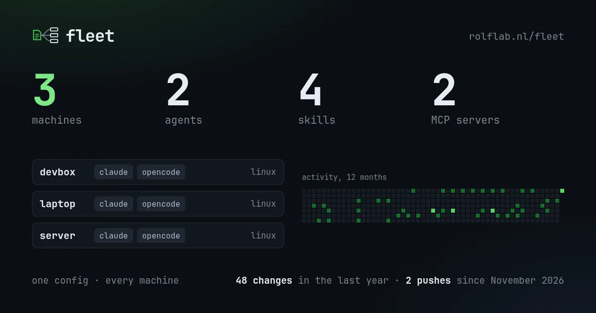

<p align="center">
  <picture>
    <source media="(prefers-color-scheme: dark)" srcset="assets/logo-dark.svg">
    
  </picture>
</p>

<p align="center">
  <a href="https://github.com/RolfKoenders/fleet/actions/workflows/ci.yml"></a>
  <a href="https://github.com/RolfKoenders/fleet/releases"></a>
</p>

# fleet

Fleet keeps your coding agents' setup the same on every machine. You store shared instructions, skills, MCP servers, settings and encrypted secrets in one private git repo, called your config. Fleet makes each machine match it, and stops to report a conflict instead of overwriting something it did not write.

## Install and get started

Install fleet and create your config:

```sh
curl -fsSL https://raw.githubusercontent.com/RolfKoenders/fleet/main/install.sh | sh
fleet new ~/fleet-config
```

The new repo is a commented example with placeholder skills and MCP servers. Ask your agent to run `fleet agent` and follow its onboarding recipe, or edit `hosts/` and `catalog/` yourself. `fleet init` fails until the placeholders are gone.

Publish it as a private repo:

```sh
cd ~/fleet-config
git add -A && git commit -m "Start my fleet config"
gh repo create fleet-config --private --source . --remote origin --push
```

Set up this machine, using its name from `hosts/`. Init prints an age key once, so save it in your password manager:

```sh
cd ~/fleet-config
fleet init laptop
```

Then add another machine from this one:

```sh
fleet init server
```

## Share your fleet

`fleet card` writes an image of your fleet to post or put in a README: the counts of machines, agents, skills and MCP servers, each machine with its agents and OS, and a year of changes. Hosts are `host 1`, `host 2` unless you add `--names`, and no server, skill or secret name is ever on it. `fleet card --badge` writes a small badge for your README. Post yours in [Show and tell](https://github.com/RolfKoenders/fleet/discussions/categories/show-and-tell).

<p align="center">
  
</p>

[](https://github.com/RolfKoenders/fleet/discussions/categories/show-and-tell)

## Supported agents

- Claude Code
- opencode
- Antigravity CLI (`agy`)

## Requirements

Linux with systemd, or macOS 12.3 or newer with Homebrew. See [Setting up machines](https://rolflab.nl/fleet/docs/setting-up-machines/) for the full list.

## In the Omarchy menu bar

On [Omarchy](https://omarchy.org/), a bar widget shows the health of every host as one icon. Its panel lists each host's first conflict and opens the bridge on the one you pick. The screenshot shows made-up hosts.

<p align="center">
  
</p>

The widget is a separate project: [fleet-omarchy](https://github.com/RolfKoenders/fleet-omarchy).

## Docs

- [Getting started](https://rolflab.nl/fleet/docs/getting-started/)
- [Setting up machines](https://rolflab.nl/fleet/docs/setting-up-machines/)
- [The bridge](https://rolflab.nl/fleet/docs/bridge/)
- [The page](https://rolflab.nl/fleet/docs/ui/)
- [Capture: turn what a machine has into config](https://rolflab.nl/fleet/docs/capture/)
- [Logging in to MCP servers](https://rolflab.nl/fleet/docs/mcp-logins/)
- [Adding an agent](https://rolflab.nl/fleet/docs/adding-an-agent/), and [Contributing](CONTRIBUTING.md)
- [Commands reference](https://rolflab.nl/fleet/docs/commands/)
- [Config reference](https://rolflab.nl/fleet/docs/reference-fleet-yaml/)
- [FAQ](https://rolflab.nl/fleet/docs/faq/)
- [Changelog](CHANGELOG.md)

## License

[MIT](LICENSE)
