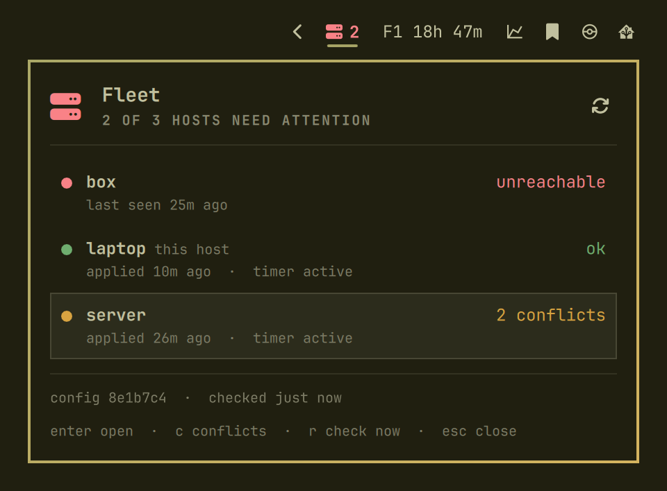

<p align="center">
  <picture>
    <source media="(prefers-color-scheme: dark)" srcset="assets/logo-dark.svg">
    
  </picture>
</p>

<p align="center">
  <a href="https://github.com/RolfKoenders/fleet/actions/workflows/ci.yml"></a>
  <a href="https://github.com/RolfKoenders/fleet/releases"></a>
</p>

# fleet

Fleet keeps your coding agents' setup the same on every machine. You store shared instructions, skills, MCP servers, settings and encrypted secrets in one private git repo, called your config. Fleet makes each machine match it, and stops to report a conflict instead of overwriting something it did not write.

## Install and get started

Install fleet and create your config:

```sh
curl -fsSL https://raw.githubusercontent.com/RolfKoenders/fleet/main/install.sh | sh
fleet new ~/fleet-config
```

Publish it as a private repo:

```sh
cd ~/fleet-config
git add -A && git commit -m "Start my fleet config"
gh repo create fleet-config --private --source . --remote origin --push
```

Set up this machine:

```sh
cd ~/fleet-config
fleet init laptop
```

Then add another machine from this one:

```sh
fleet init server
```

## Supported agents

- Claude Code
- opencode
- Antigravity CLI (`agy`)

## Requirements

Linux with systemd, or macOS 12.3 or newer with Homebrew. See [Setting up machines](https://rolflab.nl/fleet/docs/setting-up-machines/) for the full list.

## In the Omarchy menu bar

On [Omarchy](https://omarchy.org/), a bar widget shows the health of every host as one icon. Its panel lists each host's first conflict and opens the bridge on the one you pick. The screenshot shows made-up hosts.

<p align="center">
  
</p>

The widget is a separate project: [fleet-omarchy](https://github.com/RolfKoenders/fleet-omarchy).

## Docs

- [Getting started](https://rolflab.nl/fleet/docs/getting-started/)
- [Setting up machines](https://rolflab.nl/fleet/docs/setting-up-machines/)
- [The bridge](https://rolflab.nl/fleet/docs/bridge/)
- [The page](https://rolflab.nl/fleet/docs/ui/)
- [Commands reference](https://rolflab.nl/fleet/docs/commands/)
- [Config reference](https://rolflab.nl/fleet/docs/reference-fleet-yaml/)
- [FAQ](https://rolflab.nl/fleet/docs/faq/)
- [Changelog](CHANGELOG.md)

## License

[MIT](LICENSE)
