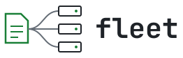

<p align="center">
  <picture>
    <source media="(prefers-color-scheme: dark)" srcset="assets/logo-dark.svg">
    
  </picture>
</p>

<p align="center">
  <a href="https://github.com/RolfKoenders/fleet/actions/workflows/ci.yml"></a>
  <a href="https://github.com/RolfKoenders/fleet/releases"></a>
</p>

# fleet

Fleet keeps the setup of your coding agents the same on every machine. You keep instructions, skills, MCP servers, settings and encrypted secrets in one private git repo, called your config, and fleet makes each machine match it.

If a machine holds something different, fleet stops and reports a conflict instead of overwriting it.

## Getting started

Install fleet and create your config:

```sh
curl -fsSL https://raw.githubusercontent.com/RolfKoenders/fleet/main/install.sh | sh
fleet new ~/fleet-config
```

The new repo is a commented example with placeholder skills and MCP servers. Ask your agent to run `fleet agent` and follow the onboarding recipe, or edit `hosts/` and `catalog/` yourself. `fleet init` fails until the placeholders are gone.

Publish it as a private repo:

```sh
cd ~/fleet-config
git add -A && git commit -m "Start my fleet config"
gh repo create fleet-config --private --source . --remote origin --push
```

Set up this machine, using its name from `hosts/`. Init prints an age key once, so save it in your password manager:

```sh
cd ~/fleet-config
fleet init laptop
```

Then add your other machines from this one:

```sh
fleet init server
```

## Working with fleet

Change the config, check the result, and publish it:

```sh
fleet diff
fleet push -m "Add a skill"
```

`fleet push` applies the change on every machine with an `ssh:` line in its host file. Every machine also pulls and applies by itself every 30 minutes.

| Command | What it does |
|---|---|
| `fleet status` | Report this machine; `--all` asks every machine over ssh; `--conflicts` lists this machine's conflicts in full, reading only |
| `fleet bridge [--view <screen>] [--host <name>]` | The full-screen view of every host (needs a terminal), optionally opened on a screen and a host; pushes and doctor only on your confirmation. See [the bridge](docs/bridge.md) |
| `fleet doctor` | Start this machine's MCP servers, check each answers and measure how large its tools are (saved as the doctor result); `--all` asks every machine over ssh. Runs commands with real credentials and may download packages, so it runs only when you ask |
| `fleet diff` | Show what an apply would change |
| `fleet apply` | Make this machine match its config |
| `fleet push` | Publish the config and apply it |
| `fleet adopt` | Take ownership of an MCP server or skill that already matches |
| `fleet secrets` | Edit, set or rekey encrypted secrets |
| `fleet skills update` | Move pinned skill sources to their latest commit |
| `fleet update` | Move the pinned tool version to the latest commit and print what changed |
| `fleet demo` | Try the bridge on made-up hosts in a throwaway sandbox; `--shell` gives a shell instead |
| `fleet agent` | Print what an agent needs to know, including task recipes |

Add `--json` to any command for output a script can read.

## Requirements

- Linux with systemd, or macOS 12.3 or newer with Homebrew (see [Setting up machines](docs/setting-up-machines.md#macos))
- Claude Code or opencode
- Node 22.18 or newer
- git
- [sops](https://github.com/getsops/sops) 3.11 or newer
- [age](https://github.com/FiloSottile/age)

On a Mac the timer is a LaunchAgent, so it runs while the user is logged in at the desktop ([details](docs/setting-up-machines.md#macos)).

## Docs

- [Setting up machines](docs/setting-up-machines.md)
- [The bridge](docs/bridge.md)
- [Logging in to MCP servers](docs/mcp-logins.md)
- [FAQ](docs/faq.md)
- [Changelog](CHANGELOG.md)
- [Releasing](docs/releasing.md)

## License

[MIT](LICENSE)
